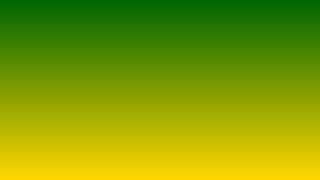

# mdview feature sample

A single document exercising everything mdview renders. Intro line with
**bold**, *italic*, ***both***, ~~strikethrough~~, `inline code`,
an [external link](https://example.com), an [anchor](#table-alignment), a
[relative doc](../README.md), an <https://github.com> bare URL, and an
<mailto:hello@example.com> address. Entities decode: &amp; &lt; &gt; &copy;.

## Headings

All six levels, largest first:

# Heading level 1

## Heading level 2

### Heading level 3

#### Heading level 4

##### Heading level 5

###### Heading level 6

Setext style works too:

Heading One
===========

Heading Two
-----------

## Paragraphs & wrapping

This is a paragraph with very long text that should wrap cleanly and maintain proper
indentation when it exceeds the view width. The text continues and demonstrates how
wrapping works for regular paragraphs in the markdown viewer, keeping the measure
comfortable on wide windows.

A soft line break follows (two trailing spaces):
this line should start on the next row without a new paragraph.

## Lists

1. First ordered item with a very long description that wraps to the next line
   and the continuation should align with the text content, not the number prefix.
2. Second item:
   1. nested ordered
   2. also nested
- Bullet item
  - nested bullet
    - deeply nested bullet with `code` and **formatting**

## Task list

- [x] Render headings, paragraphs and lists
- [x] Tables with column alignment
- [ ] Something you can check off live

## Block quotes

> A block quote with text that wraps to the next line. The continuation should
> maintain the quote indentation.
>
>> A nested quote
>>
>>> Three levels deep

## Code

```cpp
int main() {
    return 0;
}
```

```
plain fenced block, no language
```

    indented code block
    with multiple lines

## Rules

---

## Table alignment

| Left | Center | Right | Default |
| :--- | :----: | ----: | ------- |
| alpha | beta | gamma | delta |
| a very long left cell | centered | 1,000,000 | default |

## Images

Local picture (rendered inline):



Missing file (falls back to italic alt text):


Remote picture (click to load — nothing fetched until you click):


## Unicode tables

## Table 1: Pure ASCII

| Col1 | Col2 | Col3 | Col4 | Col5 | Col6 | Col7 | Col8 | Col9 | Col10 | Col11 | Col12 | Col13 | Col14 | Col15 | Col16 |
|------|------|------|------|------|------|------|------|------|-------|-------|-------|-------|-------|-------|-------|
| abc | def | ghi | jkl | mno | pqr | stu | vwx | yz1 | 234 | 567 | 890 | ABC | DEF | GHI | JKL |
| hello | world | foo | bar | baz | qux | quux | corge | grault | garply | waldo | fred | plugh | xyzzy | thud | blep |
| 100 | 200 | 300 | 400 | 500 | 600 | 700 | 800 | 900 | 1000 | 1100 | 1200 | 1300 | 1400 | 1500 | 1600 |
| yes | no | maybe | true | false | null | void | auto | int | float | double | char | bool | long | short | byte |

## Table 2: Western Unicode (accents, special chars)

| Name | French | German | Spanish | Swedish | Norwegian | Finnish | Polish | Czech | Romanian | Hungarian | Turkish | Portuguese | Italian | Dutch | Greek |
|------|--------|--------|---------|---------|-----------|---------|--------|-------|----------|-----------|---------|------------|---------|-------|-------|
| á é í | café | Müller | señor | Ångström | Ødegård | Järvenpää | Łódź | Dvořák | Brâncuși | Erdős | Çelik | São Paulo | città | fiëst | Αθήνα |
| à è ù | crème | Bärlauch | niño | Östersund | Bjørnson | Hämeenlinna | Wrocław | Novák | Timișoara | Győr | Şişli | Coração | però | naïef | Θεσσαλονίκη |
| â ê ô | château | Köln | España | Göteborg | Trøndheim | Jyväskylä | Gdańsk | Šimánek | Iași | Pécs | İstanbul | Camões | qualità | straëf | Πάτρα |
| ä ö ü | naïve | Düsseldorf | través | Malmö | Ålesund | Pärnu | Kraków | Říčany | Cluj | Debrecen | Özgür | Português | però | geënsceneerd | Ηράκλειο |
| ñ ß þ | garçon | Straße | mañana | Örebro | Fjærland | Härnösand | Łódź | Žilina | Brașov | Miskolc | Güneş | Não | Città | Groß | Σπάρτη |
| em–dash | en—dash | «quotes» | ¡Hola! | ¿Qué? | 100° | ½ ¼ ¾ | ×÷± | £€¥ | ©®™ | †‡§ | ¶•· | …‰‱ | ←→↑↓ | ∞≠≤≥ | √∑∏ |

## Table 3: Math & Technical Symbols

| Symbol | Name | Category | Unicode | Width | Example | Notes | Alt | Variant | Encoding | Use | Context | Domain | Standard | Version | Status |
|--------|------|----------|---------|-------|---------|-------|-----|---------|----------|-----|---------|--------|----------|---------|--------|
| ∀ | For all | Logic | U+2200 | 1 | ∀x∈ℝ | Quantifier | — | — | UTF-8 | Math | Logic | Mathematics | Unicode | 1.1 | Active |
| ∃ | Exists | Logic | U+2203 | 1 | ∃n∈ℕ | Quantifier | ∄ | — | UTF-8 | Math | Logic | Mathematics | Unicode | 1.1 | Active |
| ∈ | Element of | Set | U+2208 | 1 | x∈S | Membership | ∉ | — | UTF-8 | Math | Sets | Mathematics | Unicode | 1.1 | Active |
| ∩ | Intersection | Set | U+2229 | 1 | A∩B | Operation | ∪ | — | UTF-8 | Math | Sets | Mathematics | Unicode | 1.1 | Active |
| ∞ | Infinity | Number | U+221E | 1 | lim→∞ | Special | — | — | UTF-8 | Math | Calculus | Mathematics | Unicode | 1.1 | Active |
| ≤ | Less or equal | Relation | U+2264 | 1 | x≤y | Comparison | ≥ | — | UTF-8 | Math | Order | Mathematics | Unicode | 1.1 | Active |
| π | Pi | Constant | U+03C0 | 1 | 3.14159 | Greek | Π | — | UTF-8 | Math | Geometry | Mathematics | Unicode | 1.1 | Active |
| √ | Square root | Operator | U+221A | 1 | √2 | Radical | ∛ | ∜ | UTF-8 | Math | Algebra | Mathematics | Unicode | 1.1 | Active |

## Table 4: Miscellaneous Symbols (U+2600–U+27BF)

| Symbol | Code | Name | Width | Category | Notes | Used in | Example | Domain | Common | Alt | Variant | Encoding | Standard | Version | Status |
|--------|------|------|-------|----------|-------|---------|---------|--------|--------|-----|---------|----------|----------|---------|--------|
| ☀ | U+2600 | Sun | 1 | Weather | Black sun | Weather apps | ☀ Sunny | Meteorology | Yes | 🌞 | ☼ | UTF-8 | Unicode | 1.1 | Active |
| ☁ | U+2601 | Cloud | 1 | Weather | Cloud | Weather apps | ☁ Cloudy | Meteorology | Yes | 🌧 | — | UTF-8 | Unicode | 1.1 | Active |
| ☂ | U+2602 | Umbrella | 1 | Weather | Umbrella | Rain | ☂ Rainy | Meteorology | Yes | ☔ | — | UTF-8 | Unicode | 1.1 | Active |
| ★ | U+2605 | Star | 1 | Shapes | Black star | Ratings | ★★★★☆ | Rating | Yes | ⭐ | ☆ | UTF-8 | Unicode | 1.1 | Active |
| ☎ | U+260E | Phone | 1 | Objects | Telephone | Contact | ☎ Call us | Communication | Yes | 📞 | ☏ | UTF-8 | Unicode | 1.1 | Active |
| ✅ | U+2705 | Check | 2 | Marks | White check | Status | ✅ Done | UI | Yes | ✓ | ☑ | UTF-8 | Unicode | 6.0 | Active |
| ❌ | U+274C | Cross | 2 | Marks | Cross mark | Status | ❌ Error | UI | Yes | ✗ | ☒ | UTF-8 | Unicode | 6.0 | Active |
| ⭐ | U+2B50 | Star | 2 | Shapes | White medium star | Rating | ⭐ Best | Rating | Yes | ★ | 🌟 | UTF-8 | Unicode | 5.1 | Active |
| ⚠ | U+26A0 | Warning | 1 | Signs | Warning sign | Alerts | ⚠ Caution | Safety | Yes | 🚨 | — | UTF-8 | Unicode | 4.0 | Active |
| ♠ | U+2660 | Spade | 1 | Cards | Card suit | Games | ♠ Ace | Games | Yes | 🂡 | — | UTF-8 | Unicode | 1.1 | Active |
| ♥ | U+2665 | Heart | 1 | Cards | Card suit | Games | ♥ Hearts | Games | Yes | ❤ | 🧡 | UTF-8 | Unicode | 1.1 | Active |
| ♦ | U+2666 | Diamond | 1 | Cards | Card suit | Games | ♦ Diamonds | Games | Yes | 💎 | — | UTF-8 | Unicode | 1.1 | Active |

## Table 5: Modern Emoji (U+1F300–U+1F9FF)

| Emoji | Code | Name | Category | Subcategory | Width | Skin tones | ZWJ | Notes | Example | Alt | Version | Common | Domain | Use | Status |
|-------|------|------|----------|-------------|-------|------------|-----|-------|---------|-----|---------|--------|--------|-----|--------|
| 😀 | U+1F600 | Grinning | Smileys | Face | 2 | No | No | Basic face | 😀 Happy | 🙂 | 6.1 | Yes | Social | Emotion | Active |
| 😂 | U+1F602 | Joy | Smileys | Face | 2 | No | No | Tears of joy | 😂 LOL | 🤣 | 6.0 | Yes | Social | Emotion | Active |
| ❤ | U+2764 | Heart | Symbols | Emotion | 2 | No | No | Red heart | I ❤ you | 💕 | 1.1 | Yes | Social | Love | Active |
| 🔥 | U+1F525 | Fire | Travel | Event | 2 | No | No | Fire | 🔥 Hot | — | 6.0 | Yes | Social | Emphasis | Active |
| 🎉 | U+1F389 | Party | Activities | Event | 2 | No | No | Party popper | 🎉 Congrats | — | 6.0 | Yes | Social | Celebration | Active |
| 🚀 | U+1F680 | Rocket | Travel | Transport | 2 | No | No | Rocket ship | 🚀 Launch | — | 6.0 | Yes | Tech | Transport | Active |
| 💻 | U+1F4BB | Laptop | Objects | Computer | 2 | No | No | Personal computer | 💻 Dev | 🖥 | 6.0 | Yes | Tech | Work | Active |
| 🐱 | U+1F431 | Cat | Animals | Animal face | 2 | No | No | Cat face | 🐱 Meow | 😺 | 6.0 | Yes | Animals | Pet | Active |
| 🌍 | U+1F30D | Earth | Travel | Place | 2 | No | No | Globe Europe | 🌍 World | 🌎 | 6.0 | Yes | Geography | Earth | Active |
| 🍕 | U+1F355 | Pizza | Food | Food | 2 | No | No | Pizza slice | 🍕 Yum | — | 6.0 | Yes | Food | Food | Active |

## Table 6: Color Circles and Flags (Mixed ranges)

| Symbol | Name | Hex | Category | Width | R | G | B | Alpha | CSS | Use | Example | Notes | Encoding | Version | Status |
|--------|------|-----|----------|-------|---|---|---|-------|-----|-----|---------|-------|----------|---------|--------|
| 🔴 | Red Circle | U+1F534 | Circles | 2 | 255 | 0 | 0 | 255 | #FF0000 | Status | 🔴 Error | LARGE | UTF-8 | 6.0 | Active |
| 🟠 | Orange Circle | U+1F7E0 | Circles | 2 | 255 | 165 | 0 | 255 | #FFA500 | Status | 🟠 Warning | LARGE | UTF-8 | 12.0 | Active |
| 🟡 | Yellow Circle | U+1F7E1 | Circles | 2 | 255 | 255 | 0 | 255 | #FFFF00 | Status | 🟡 Caution | LARGE | UTF-8 | 12.0 | Active |
| 🟢 | Green Circle | U+1F7E2 | Circles | 2 | 0 | 255 | 0 | 255 | #00FF00 | Status | 🟢 OK | LARGE | UTF-8 | 12.0 | Active |
| 🔵 | Blue Circle | U+1F535 | Circles | 2 | 0 | 0 | 255 | 255 | #0000FF | Status | 🔵 Info | LARGE | UTF-8 | 6.0 | Active |
| 🟣 | Purple Circle | U+1F7E3 | Circles | 2 | 128 | 0 | 128 | 255 | #800080 | Status | 🟣 Special | LARGE | UTF-8 | 12.0 | Active |
| ⚫ | Black Circle | U+26AB | Circles | 1 | 0 | 0 | 0 | 255 | #000000 | Status | ⚫ Off | MEDIUM | UTF-8 | 4.1 | Active |
| ⚪ | White Circle | U+26AA | Circles | 1 | 255 | 255 | 255 | 255 | #FFFFFF | Status | ⚪ Empty | MEDIUM | UTF-8 | 4.1 | Active |

## Table 7: Mixed Content (stress test)

| ID | ASCII | Western | Math | Misc Symbol | Emoji | Mixed | Long text | Number | Code | Flag | Status | Priority | Category | Tag | Notes |
|----|-------|---------|------|-------------|-------|-------|-----------|--------|------|------|--------|----------|----------|-----|-------|
| 1 | hello | café | ∞ | ★ | 😀 | café★😀 | This is a longer text entry | 3.14159 | `code` | — | ✅ Done | 🔴 High | A | #tag | Normal |
| 2 | world | naïve | ≤ | ☀ | 🚀 | naïve☀🚀 | Another longer text entry here | 2.71828 | `func()` | — | ❌ Fail | 🟠 Med | B | #bug | Issue |
| 3 | foo | Müller | π | ✅ | 🎉 | Müller✅🎉 | Yet another entry with more text | 1.41421 | `var` | — | ⚠ Warn | 🟡 Low | C | #feat | Warning |
| 4 | bar | señor | √ | ⭐ | 💻 | señor⭐💻 | A cell with quite a bit of content | 0.57721 | `type` | — | ✅ Done | 🟢 OK | D | #done | Fixed |
| 5 | baz | Ångström | ∑ | 🔥 | 🌍 | Ångström🔥🌍 | More text content in this cell here | 1.73205 | `class` | — | ❌ Fail | 🔵 Info | E | #wip | Pending |
| 6 | qux | Łódź | ∏ | ❤ | 🐱 | Łódź❤🐱 | Even more text content for testing | 2.30258 | `def` | — | ✅ Done | 🟣 Spec | F | #test | OK |


## Table 8: Modern Emoji — Faces & People

| Symbol | Name | Hex | Category | Width | Example | Notes | Status |
|--------|------|-----|----------|-------|---------|-------|--------|
| 😀 | Grinning | U+1F600 | Smileys | 2 | 😀 Happy | Grinning face | Active |
| 😂 | Joy | U+1F602 | Smileys | 2 | 😂 LOL | Tears of joy | Active |
| 😍 | Heart eyes | U+1F60D | Smileys | 2 | 😍 Love | Smiling with hearts | Active |
| 😎 | Cool | U+1F60E | Smileys | 2 | 😎 Cool | Sunglasses face | Active |
| 😭 | Crying | U+1F62D | Smileys | 2 | 😭 Sad | Loudly crying | Active |
| 😱 | Scream | U+1F631 | Smileys | 2 | 😱 Wow | Face screaming | Active |
| 🤔 | Thinking | U+1F914 | Smileys | 2 | 🤔 Hmm | Thinking face | Active |
| 🤖 | Robot | U+1F916 | Smileys | 2 | 🤖 AI | Robot face | Active |
| 🥳 | Party | U+1F973 | Smileys | 2 | 🥳 Yay | Partying face | Active |
| 🤯 | Exploding | U+1F92F | Smileys | 2 | 🤯 Mind blown | Exploding head | Active |
| 🙈 | See no evil | U+1F648 | Monkeys | 2 | 🙈 Hide | Monkey covering eyes | Active |
| 🙉 | Hear no evil | U+1F649 | Monkeys | 2 | 🙉 Deaf | Monkey covering ears | Active |
| 🙊 | Speak no evil | U+1F64A | Monkeys | 2 | 🙊 Mute | Monkey covering mouth | Active |
| 👀 | Eyes | U+1F440 | Body | 2 | 👀 Watch | Eyes | Active |
| 👍 | Thumbs up | U+1F44D | Hand | 2 | 👍 Good | Thumbs up | Active |
| 👎 | Thumbs down | U+1F44E | Hand | 2 | 👎 Bad | Thumbs down | Active |
| 👏 | Clapping | U+1F44F | Hand | 2 | 👏 Bravo | Clapping hands | Active |
| 🤝 | Handshake | U+1F91D | Hand | 2 | 🤝 Deal | Handshake | Active |
| 💪 | Muscle | U+1F4AA | Body | 2 | 💪 Strong | Flexed bicep | Active |
| 🧠 | Brain | U+1F9E0 | Body | 2 | 🧠 Think | Brain | Active |

## Table 9: Modern Emoji — Objects & Nature

| Symbol | Name | Hex | Category | Width | Example | Notes | Status |
|--------|------|-----|----------|-------|---------|-------|--------|
| 🔥 | Fire | U+1F525 | Nature | 2 | 🔥 Hot | Fire | Active |
| 💧 | Droplet | U+1F4A7 | Nature | 2 | 💧 Water | Water droplet | Active |
| 🌊 | Wave | U+1F30A | Nature | 2 | 🌊 Ocean | Water wave | Active |
| 🌋 | Volcano | U+1F30B | Nature | 2 | 🌋 Erupt | Volcano | Active |
| 🌍 | Earth EU | U+1F30D | Nature | 2 | 🌍 World | Globe Europe-Africa | Active |
| 🌙 | Moon | U+1F319 | Space | 2 | 🌙 Night | Crescent moon | Active |
| 🌟 | Glowing star | U+1F31F | Space | 2 | 🌟 Shine | Glowing star | Active |
| 🚀 | Rocket | U+1F680 | Transport | 2 | 🚀 Launch | Rocket | Active |
| 🛸 | UFO | U+1F6F8 | Transport | 2 | 🛸 Alien | Flying saucer | Active |
| 💻 | Laptop | U+1F4BB | Tech | 2 | 💻 Code | Laptop computer | Active |
| 🖥 | Desktop | U+1F5A5 | Tech | 2 | 🖥 PC | Desktop computer | Active |
| 💾 | Floppy | U+1F4BE | Tech | 2 | 💾 Save | Floppy disk | Active |
| 📱 | Phone | U+1F4F1 | Tech | 2 | 📱 Mobile | Mobile phone | Active |
| 🔋 | Battery | U+1F50B | Tech | 2 | 🔋 Power | Battery | Active |
| 💡 | Bulb | U+1F4A1 | Objects | 2 | 💡 Idea | Light bulb | Active |
| 🔧 | Wrench | U+1F527 | Tools | 2 | 🔧 Fix | Wrench | Active |
| 🔨 | Hammer | U+1F528 | Tools | 2 | 🔨 Build | Hammer | Active |
| 🗑 | Trash | U+1F5D1 | Objects | 2 | 🗑 Delete | Wastebasket | Active |
| 📦 | Package | U+1F4E6 | Objects | 2 | 📦 Ship | Package | Active |
| 📁 | Folder | U+1F4C1 | Objects | 2 | 📁 Dir | File folder | Active |
| 🐱 | Cat | U+1F431 | Animals | 2 | 🐱 Meow | Cat face | Active |
| 🐶 | Dog | U+1F436 | Animals | 2 | 🐶 Woof | Dog face | Active |
| 🦊 | Fox | U+1F98A | Animals | 2 | 🦊 Sly | Fox face | Active |
| 🦁 | Lion | U+1F981 | Animals | 2 | 🦁 Roar | Lion face | Active |
| 🐧 | Penguin | U+1F427 | Animals | 2 | 🐧 Linux | Penguin | Active |
| 🦄 | Unicorn | U+1F984 | Animals | 2 | 🦄 Magic | Unicorn face | Active |
| 🍕 | Pizza | U+1F355 | Food | 2 | 🍕 Yum | Pizza slice | Active |
| 🍺 | Beer | U+1F37A | Food | 2 | 🍺 Cheers | Beer mug | Active |
| ☕ | Coffee | U+2615 | Food | 1 | ☕ Morning | Hot beverage | Active |
| 🎉 | Party | U+1F389 | Events | 2 | 🎉 Congrats | Party popper | Active |
